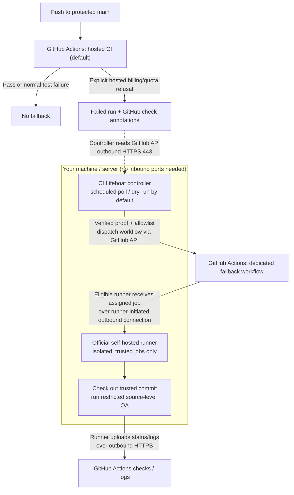

# CI Lifeboat

**When hosted CI runs out, your builds stay afloat.**

An experimental, evidence-verified fallback controller for GitHub Actions.
GitHub-hosted CI remains the default. If a completed Actions run fails because
GitHub explicitly refuses to start a hosted job for quota or billing reasons,
CI Lifeboat can dispatch a separate, tightly restricted, self-hosted QA workflow
for the **same branch SHA**.

**Pre-release:** This is an independently extracted public-source preview.
Do not treat this as an audited CI, isolation, release, or security product.

## Architecture: how GitHub reaches a self-hosted runner

**GitHub never needs to initiate a connection to your computer.** Two separate
processes make **outbound HTTPS connections (TCP 443)** to GitHub:

1. **CI Lifeboat controller** (Python CLI, optionally scheduled): polls the
   GitHub API for a failed hosted Actions run on the trusted branch's **exact
   current commit**, checks for an explicit quota/billing-refusal annotation,
   and, if permitted, dispatches a dedicated workflow. It does **not** accept
   incoming connections, execute repository code, or register a runner.
2. **Official GitHub Actions self-hosted runner** (on your own host, container,
   or disposable VM): registers with GitHub using its registration flow,
   maintains outbound communication to receive eligible jobs, and reports job
   logs/status back to GitHub. **GitHub assigns jobs to the registered runner;
   CI Lifeboat does not remotely contact the runner.**



### Connection and trust boundaries

| Component | Runs where | Connection direction | What it can do |
| --- | --- | --- | --- |
| GitHub Actions hosted CI | GitHub | GitHub-managed | Default builds and tests |
| CI Lifeboat controller | Your Linux host or scheduler | **Outbound** HTTPS to GitHub API | Read evidence; dispatch only allowlisted workflows |
| Official self-hosted runner | Your isolated machine/container/VM | **Outbound** to GitHub | Receive eligible jobs, run QA, publish results |
| Self-hosted job | Isolated runner environment | Outbound as needed | Execute approved source-level checks |

The runner is registered once with GitHub using the official setup procedure
(which uses a short-lived registration token). Later, it maintains authenticated
outbound communication to obtain work. **No public IP, port forwarding, inbound
firewall rule, reverse proxy, or Cloudflare Tunnel is needed for normal GitHub
Actions runner connectivity.** Your network must permit the GitHub runner's
required outbound endpoints, not only the API.

**When the desktop is offline:** the runner shows offline; a queued fallback
job cannot run until an eligible runner is available and the job has not timed
out. If the controller is offline, no new fallback is dispatched. A GitHub
API error or missing quota proof means **fail closed**, not an automatic switch.

**Security boundary:** GitHub runner-group restrictions, a protected branch,
a read-only job token, and isolation are **mandatory operational setup**; the
controller cannot enforce them by itself. A container is not a strong boundary
for adversarial source code. Use dedicated ephemeral machines or VMs for
untrusted workloads, never a personal desktop with credentials. Public forks
must not be allowed to trigger self-hosted jobs.

### Decision sequence

1. GitHub-hosted CI runs normally.
2. If GitHub **explicitly** rejects the hosted job for quota/billing, its failed
   run and check annotations provide evidence.
3. The controller verifies the configured repository/branch, exact current SHA,
   quota annotation, and absence of a previous fallback dispatch.
4. GitHub receives `workflow_dispatch` for that branch.
5. An eligible self-hosted runner receives the workflow via **its own outbound
   connection**, independently rechecks proof **before checkout**, then runs a
   deliberately limited QA recipe.
6. Results appear in GitHub Actions. This is **additional QA**, not automatic
   replacement of branch-protection or production release gates.

## Safety model

- Default: **dry-run**; dispatch requires `--dispatch`.
- Explicit per-repository allowlist; **public repositories denied by default**.
- Requires exact branch and commit, failed hosted run, and explicit quota
  annotation. Ordinary test failures and queued jobs never trigger dispatch.
- Refuses duplicate fallback workflows for the same commit.
- The self-hosted job independently rechecks the evidence **before checkout**.
- The example self-hosted workflow runs on protected `main`, has read-only
  permissions, and uses `make ci-fallback` with no release/deploy steps.
- Must be paired with a GitHub **runner group allowing only one workflow**,
  trusted protected branch, isolated containers/VMs, non-root execution, no
  Docker socket, no production secrets, and restricted network/permissions.

**Important:** Self-hosted runners execute repository code; containerization
does not guarantee safety from malicious workloads. Never allow fork PR jobs
to run on a machine containing valuable data. Configuring
`allow_public = true` is a deliberate high-risk opt-in, **not** a security
approval, and requires a separate isolated, disposable runner fleet. The
project does not configure GitHub runner groups for you.

## Requirements

- Python 3.11+
- GitHub CLI (`gh`) with a token able to read repository, Actions and check
  annotations, and dispatch an approved workflow (for private repositories).
- On runners: Linux, `curl`, `jq`, `make`, and the repository's QA tools.
- GitHub Actions self-hosted runner configured and restricted separately.
- systemd --user is optional; other schedulers can call the CLI.

## Setup

```sh
python3 -m pip install .
mkdir -p ~/.config/ci-lifeboat
cp examples/config.toml ~/.config/ci-lifeboat/config.toml
# Edit the file: add only repositories you own and have explicitly approved.
gh auth status
ci-lifeboat                              # Read-only evaluation
ci-lifeboat --repo your-org/your-private-repo
ci-lifeboat --dispatch                   # Only after verifying installation
```

For a recurring check, customize and install `systemd/ci-lifeboat.service`
and `systemd/ci-lifeboat.timer` under
`~/.config/systemd/user/`, then:

```sh
systemctl --user daemon-reload
systemctl --user enable --now ci-lifeboat.timer
systemctl --user status ci-lifeboat.timer
```

**Do not enable the timer before runner group and repository controls are
verified.** A personal `gh auth login` may have broader privileges than
needed; prefer a dedicated minimally scoped credential. No credentials belong
in this repository.

## Install the fallback workflow

1. Copy `examples/ci-lifeboat.yml` into the allowed repository at
   `.github/workflows/ci-lifeboat.yml` on protected `main`.
2. Create a **dedicated** GitHub runner group, granting the selected repository
   and this exact workflow access, limited to protected `main`.
3. Set a unique self-hosted label; change `runs-on` to match.
4. Add a deliberate, secret-free `ci-fallback` Makefile target. Missing
   targets are failures, never green no-ops.
5. Review the runner's isolation, network, credentials, persistent workspace,
   and patching policy. Ephemeral runners are strongly preferred.
6. Test the read-only CLI and synthetic unit tests. A real hosted quota
   refusal is needed to qualify a live dispatch; do not manufacture one.
7. Check GitHub branch protection/release requirements are unchanged.

This workflow is intentionally **not equivalent** to full hosted CI and does
not automatically satisfy the repository's branch protection, integration,
vulnerability, artifact-attestation or deployment requirements.

## Configuration

Each `[[repositories]]` entry accepts:

| Key | Default | Meaning |
| --- | --- | --- |
| `name` | required | Exact `owner/repo` allowlist |
| `branch` | `main` | Trusted branch; change workflow guard too |
| `workflow` | `ci-lifeboat.yml` | Dispatchable workflow filename |
| `workflow_name` | `CI Lifeboat QA` | Used to detect duplicate dispatches |
| `allow_public` | `false` | High-risk explicit public-repository opt-in |

The included example workflow is specialized for protected `main`. If you
change `branch`, update and review the workflow's independent guard.

## Limitations

- Polling, not a GitHub-native failover or automatic reroute of queued jobs.
- GitHub must have created a failed run and annotation; otherwise it does
  nothing. Failure to reach the API fails closed.
- The watcher inspects the latest 100 matching workflow runs and each
  candidate run's first 100 jobs and annotation page. It never assumes
  pagination gaps mean success or invents quota proof.
- Requires trust in GitHub's available Actions/check-run evidence.
- It does not provision, harden, clean or unregister self-hosted runners.
- The example workflow is a template, not a tested deployment recipe.

## Contributing and security

See [CONTRIBUTING.md](CONTRIBUTING.md) and [SECURITY.md](SECURITY.md).
Tests: `python3 -m unittest discover -s tests -v`.

## Release readiness

Follow [RELEASE.md](RELEASE.md) before publishing:

- Run tests, package build and a source/commit-history secret scan.
- Review GitHub Actions pinning, workflow permissions and runner security.
- Confirm this **public source repository** uses GitHub-hosted CI only; never
  grant its fork PRs access to private desktop runner groups.
- Manually validate both dry-run and fail-closed behavior against a safe repo.
- Verify release governance and keep the original private installation unchanged.

Licensed under Apache-2.0.
