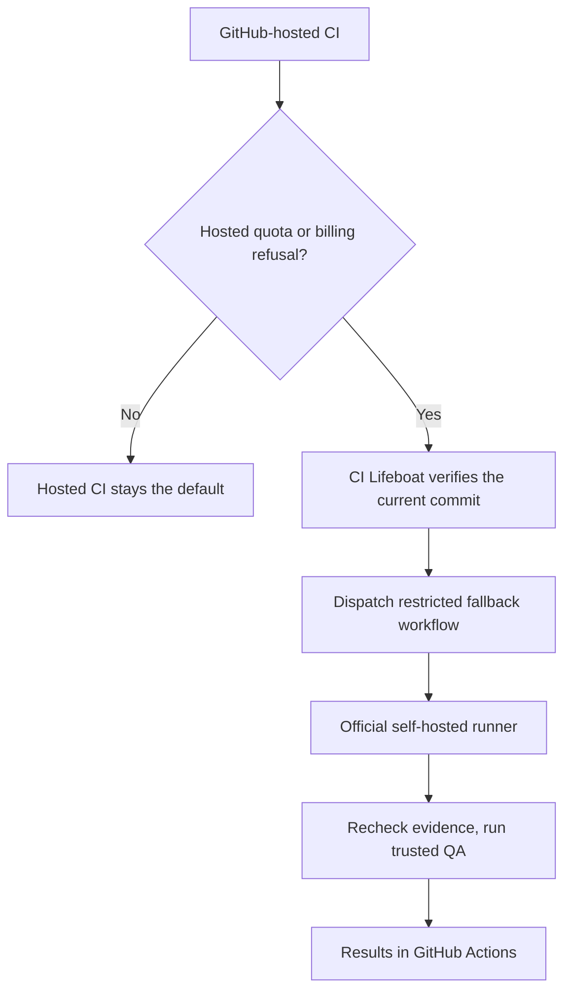

# CI Lifeboat

**When GitHub-hosted CI can't start because of a billing or quota limit, keep trusted QA running on your own runner.**

CI Lifeboat is a small, self-hosted **GitHub Actions fallback controller**. It checks for an **explicit, verified GitHub-hosted quota/billing refusal** on the current trusted commit, then dispatches a separate, restricted QA workflow to an official self-hosted runner. GitHub-hosted CI stays the default.

> **Early preview (v0.1.0).** Not a general CI service, a solution for ordinary test failures, or a substitute for branch-protection and production release gates.

## Features

- **Evidence-first:** fallback only for a confirmed GitHub billing/quota refusal, not test failures or queued jobs.
- **Safe by default:** dry-run mode, explicit repository allowlist, public repositories denied by default.
- **Commit-aware:** checks the current protected-branch SHA; skips previously dispatched fallbacks.
- **Independent verification:** the self-hosted workflow checks evidence again **before checking out code**.
- **Your infrastructure:** official self-hosted runners; no inbound ports, tunnel, or public desktop IP required.
- **Small footprint:** Python CLI, TOML configuration, optional systemd timer.

## How it works



**Two outbound connections, no inbound connection to your desktop:** CI Lifeboat polls and dispatches using the GitHub API; the **official GitHub runner** independently connects to GitHub to accept jobs and send results. CI Lifeboat never contacts the runner directly.

For security boundaries, offline behavior, and the exact triggering rules, see [Architecture](docs/ARCHITECTURE.md).

## Install with a coding agent

Give this prompt to **Claude Code, Codex, or another coding agent with terminal/GitHub access**. Use the copy button on the code block:

```text
Install CI Lifeboat for my GitHub Actions repositories:
https://github.com/olaryn-lab/ci-lifeboat

First read AGENTS.md and docs/INSTALL.md in that repository.
Inspect my existing CI and propose an explicit trusted-repository
allowlist, limited QA target, and runner isolation plan.

Before making changes, get my approval. Do not register runners,
change runner groups, add workflows, enable timers, dispatch jobs,
or change GitHub settings without approval.

Never print or commit credentials. Once approved, implement the
restricted setup, run offline tests and dry-run verification, check
failure behavior, and report what was installed and what still needs
a real quota refusal to validate.

Keep existing hosted CI and protected release gates unchanged.
```

The repo includes [agent-specific installation rules](AGENTS.md) so agents can execute the approved installation safely instead of guessing.

## Install manually

Requires **Python 3.11+**, the [GitHub CLI](https://cli.github.com/) (`gh`) and an **independently registered, restricted** GitHub Actions runner.

```bash
git clone https://github.com/olaryn-lab/ci-lifeboat.git
cd ci-lifeboat
pipx install .
mkdir -p ~/.config/ci-lifeboat
cp examples/config.toml ~/.config/ci-lifeboat/config.toml
# Edit config.toml: replace the example with an approved private repository.
ci-lifeboat                          # Dry run; no dispatch
```

Before enabling jobs, follow the [step-by-step installation guide](docs/INSTALL.md) to install the restricted workflow, configure runner-group access, verify the `ci-fallback` QA target, and optionally enable scheduling. **Do not run `--dispatch` until those checks pass.**

## Security and supported scope

CI Lifeboat is designed for **explicitly approved repositories, one dedicated fallback workflow, and a protected branch (typically `main`)**. The controller verifies a quota refusal for the current commit; GitHub runner-group restrictions determine which workflow can use your desktop runner. **Repository selection alone is not the execution boundary:** the workflow and branch restrictions matter too.

In this setup, contributor PRs use ordinary GitHub-hosted CI; the desktop fallback handles **approved protected-branch QA only**. Keep the runner isolated, without a host Docker socket or production credentials. Containers reduce risk but are not a complete sandbox.

[Security policy](SECURITY.md) · [Contributing](CONTRIBUTING.md) · [Release checklist](RELEASE.md) · [Configuration](docs/INSTALL.md#configuration)

**License:** [Apache-2.0](LICENSE).
