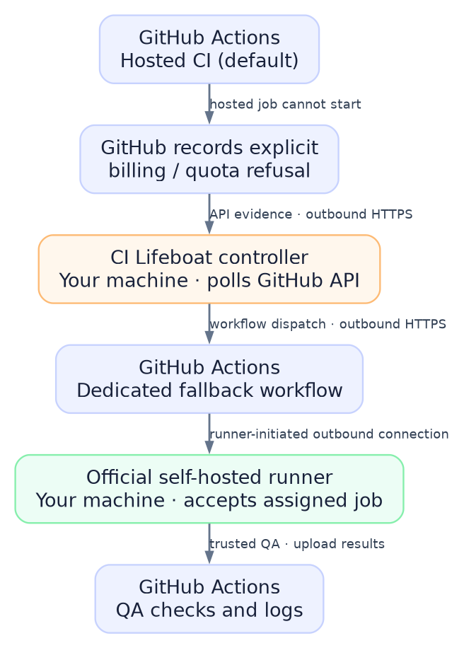

# Architecture

[← README](../README.md)

CI Lifeboat is a **quota-aware dispatch controller**, not a GitHub Actions runner implementation. GitHub's official self-hosted runner performs registration, job execution and result upload.

[Editable Mermaid source](architecture.mmd) · [Graphviz source used to render the PNG](architecture.dot) · [Scalable SVG](architecture.svg)

## Who connects to whom?

| Component | Runs on | Connectivity | Role |
| --- | --- | --- | --- |
| GitHub-hosted Actions | GitHub | GitHub-managed | Default CI |
| CI Lifeboat controller | Your Linux machine or a scheduled host | **Outbound HTTPS (443) to GitHub API** | Poll for evidence and dispatch an approved workflow |
| Official GitHub self-hosted runner | Your isolated host, container or VM | **Runner-initiated outbound connections to GitHub** | Accept eligible work, execute QA, upload results |
| Fallback job | Your isolated runner | Outbound as required by the approved QA recipe | Independently verify quota proof **before checkout** |

The runner is registered with GitHub using its official registration mechanism, including a short-lived registration token. It then authenticates and stays connected to GitHub to receive eligible jobs. **GitHub assigns jobs to a registered runner**; the controller does not open a connection to the runner.

No inbound firewall port, public desktop IP, reverse proxy, Cloudflare Tunnel, or port forwarding is needed for standard runner operations. The runner needs access to GitHub's required outbound endpoints (which can extend beyond the REST API). Refer to GitHub's current [self-hosted runner networking guidance](https://docs.github.com/en/actions/how-tos/manage-runners/self-hosted-runners/communicate-with-self-hosted-runners).

## Exact decision flow

1. A push to the approved, protected branch starts normal GitHub-hosted CI.
2. The controller periodically polls GitHub Actions for that branch's **current SHA**.
3. It checks failed hosted runs' check-run annotations for **explicit** GitHub billing/quota-refusal evidence. Ordinary test failures, queued jobs, unrelated outages, and missing evidence **never qualify**.
4. It checks the allowlist and prevents duplicate fallback dispatches for the same SHA.
5. With `--dispatch` enabled, it calls GitHub's `workflow_dispatch` API for the dedicated fallback workflow.
6. GitHub assigns the workflow job to an eligible, **restricted** self-hosted runner. The runner must be registered and online; the controller does not execute any project code.
7. The workflow independently verifies the same current SHA and quota annotation **before checkout**. It then runs a limited, explicitly approved `make ci-fallback` quality target and reports status through GitHub Actions.
8. Fallback results **do not automatically replace** hosted integration tests, supply-chain checks, branch-protection checks, attestations, publication or production deployment gates.

**If the desktop is off:** the controller cannot dispatch new work. Already-dispatched fallback jobs may queue until a runner comes online, or time out. **If the GitHub API is unavailable or evidence is ambiguous:** the controller fails closed.

## Trust boundaries

The controller's configured repository list is only **one layer**. Operators must separately configure GitHub runner groups to allow precisely the intended repository, workflow and trusted branch. Use dedicated ephemeral runners/VMs where possible; non-root containers, no host Docker socket, minimal permissions, no production secrets, and restricted networking reduce the blast radius but do not eliminate it.

A public copy of the **CI Lifeboat source repository** must use **GitHub-hosted CI only** for contributions. Never expose a personal desktop runner to untrusted fork pull requests. See [SECURITY.md](../SECURITY.md) and the [installation guide](INSTALL.md).
